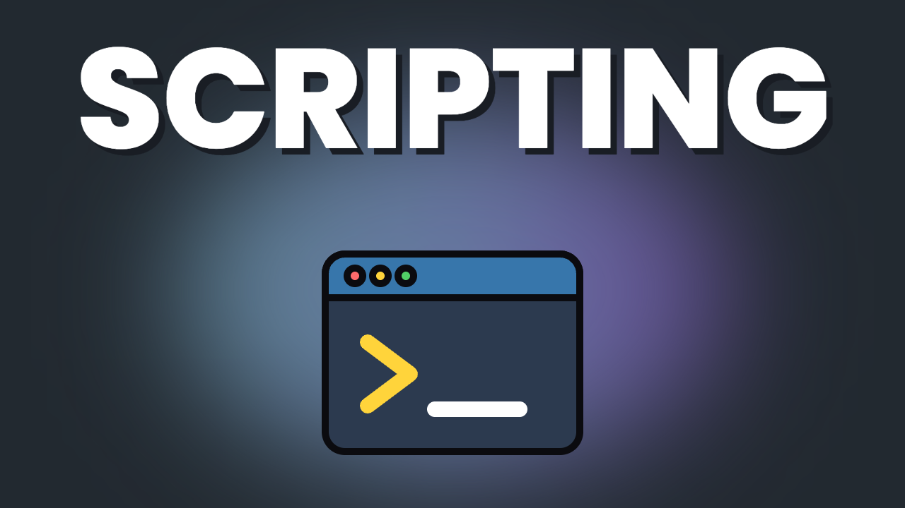
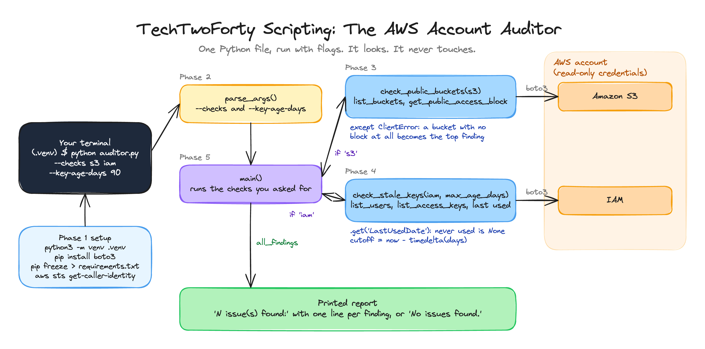

<p align="center">
  
</p>

<h1 align="center">TechTwoForty: Scripting</h1>
<p align="center"><b>The AWS Account Auditor</b> · the finished project</p>
<p align="center">
  <a href="https://github.com/wjpearce-github/TechTwoForty-Linux">← Previous: Linux</a> ·
  <a href="https://github.com/wjpearce-github/TechTwoForty-Start-Here">Course map</a> ·
  <a href="https://github.com/wjpearce-github/TechTwoForty-Cloud">Next: Cloud →</a>
</p>

> [!TIP]
> **This repo is the finished template for the Scripting project. Treat it as your cheat sheet.**
> `aws-auditor/auditor.py` is the complete file you have once all five phases are pasted in, in the same order. Build yours piece by piece first, then compare it with this one line by line.

| | |
|---|---|
| **Section** | 2 of 10 · Python |
| **Time** | About 60 minutes, 5 phases |
| **Runs on** | Python 3 on your machine, with **read-only** AWS credentials |
| **Deliverable** | `auditor.py`: a command-line tool that flags public S3 buckets and stale IAM keys |
| **Comes back in** | The capstone, Stage 4, run against the account that hosts production |

## The big picture



<sub>Drawn in Excalidraw. To edit it, open <code>assets/diagram.excalidraw</code> at <a href="https://excalidraw.com">excalidraw.com</a>.</sub>

## What is in this repo

```text
TechTwoForty-Scripting/
└── aws-auditor/
    ├── auditor.py          The finished tool: flags, two checks, main()
    └── requirements.txt    pip freeze after pip install boto3
```

Run it yourself:

```bash
cd aws-auditor
python3 -m venv .venv && source .venv/bin/activate
pip install -r requirements.txt
aws sts get-caller-identity       # prove the credentials work first
python auditor.py
```

## Cheat sheet, phase by phase

### Phase 1 · Set up the project

```bash
mkdir aws-auditor && cd aws-auditor && python3 -m venv .venv && source .venv/bin/activate
pip install boto3 && pip freeze > requirements.txt
aws sts get-caller-identity
```

**You should see:** `(.venv)` at the start of your prompt, then your account ID, user ID and ARN. If `sts` fails, nothing else will work. "The script is broken" and "my credentials are wrong" look the same from the inside.

### Phase 2 · The skeleton
`parse_args()` with two flags, before any real work: `--checks` (default `s3 iam`) and `--key-age-days` (default `90`).

### Phase 3 · Check one: public buckets
`check_public_buckets(s3)` lists every bucket and calls `get_public_access_block` on each one.

> [!IMPORTANT]
> A bucket with **no** public access block does not return "false". It raises a `ClientError`. Without the `except`, the script would crash on exactly the worst bucket. With it, that bucket becomes the top finding.

### Phase 4 · Check two: stale keys
`check_stale_keys(iam, max_age_days)` walks every user, then every key, and flags any key not used since the cutoff.

- Nested loops: users, then each user's keys
- `.get("LastUsedDate")`: a key that has never been used has no date at all, so square brackets would crash
- `max_age_days` is a parameter. That is how the `--key-age-days` flag reaches the check

### Phase 5 · Wire it together and run it

```bash
python auditor.py                                  # both checks
python auditor.py --checks s3                      # S3 only, IAM never runs
python auditor.py --checks iam --key-age-days 30   # stricter, probably more findings
```

Three runs, three behaviours, no code changes. That is the argument for `argparse`.

**You should see:** `Checking S3 buckets...`, `Checking IAM access keys...`, then either `N issue(s) found:` with one line per finding, or `No issues found.`

> [!NOTE]
> The walkthrough has you paste each phase at the bottom of the file, so `from datetime import ...` ends up halfway down, just above `check_stale_keys`. That is why it is there in this file too: it matches yours. Python is happy either way. In tools you write from scratch, put every import at the top.

## Final handover check

- [ ] `auditor.py` runs clean with no flags
- [ ] Each flag changes the behaviour without editing the file
- [ ] You can explain what would happen without the `try/except` in the S3 check
- [ ] `requirements.txt` exists, so someone else could rebuild your environment

## Common mistakes

| Mistake | What happens | The fix |
|---|---|---|
| Running `python auditor.py` before `main()` exists | Nothing happens, or a `NameError` | The file only runs once Phase 5 is in |
| Credentials with write access | The auditor could change things | Use read-only credentials. Least privilege applies to your own tools |
| Forgetting to activate `.venv` | `ModuleNotFoundError: boto3` | `source .venv/bin/activate` |
| `key["LastUsedDate"]` with square brackets | `KeyError` on a key that was never used | `.get("LastUsedDate")` |
| Skipping ahead and pasting all phases at once | Five bugs at once instead of one | Run the test after each phase |

## Stretch goals

From the walkthrough: add a `--json` flag that prints the findings as JSON, or a third check for security groups open to `0.0.0.0/0`.

## What you can now do

- **Tool building:** a Python script with flags and error handling, not a throwaway
- **The AWS SDK:** boto3 clients for S3 and IAM, called from your own code
- **Defensive code:** errors caught and turned into findings instead of crashes
- **Cloud security:** two of the most common AWS misconfigurations, checked automatically

---

<p align="center">
  <b>TechTwoForty</b> · Scripting · 2 of 10<br>
  <a href="https://github.com/wjpearce-github/TechTwoForty-Linux">← Previous: Linux</a> ·
  <a href="https://github.com/wjpearce-github/TechTwoForty-Start-Here">Course map</a> ·
  <a href="https://github.com/wjpearce-github/TechTwoForty-Cloud">Next: Cloud →</a>
</p>
